# AyudaCampus

## Descripción
**AyudaCampus** es una aplicación móvil nativa para Android desarrollada con **Jetpack Compose**, **Room Database** y la arquitectura **MVVM (Model-View-ViewModel)**. Su objetivo principal es facilitar la gestión, seguimiento y atención de solicitudes y tickets de soporte técnico dentro de la comunidad universitaria, ofreciendo perfiles diferenciados para **Clientes (Estudiantes/Docentes)** y **Personal de Soporte (Administradores)**.

---

## Árbol de Paquetes (`com.tecsup.ayudacampus`)

```text
com.tecsup.ayudacampus
│
├── AyudaApp.kt
├── MainActivity.kt
│
├── data/
│   ├── local/
│   │   ├── AyudaDatabase.kt
│   │   ├── DatosIniciales.kt
│   │   ├── dao/
│   │   │   ├── CategoriaDao.kt
│   │   │   ├── TicketDao.kt
│   │   │   └── UsuarioDao.kt
│   │   └── entity/
│   │       ├── Categoria.kt
│   │       ├── Comentario.kt
│   │       ├── Ticket.kt
│   │       └── Usuario.kt
│   ├── prefs/
│   │   └── PreferenciasStore.kt
│   └── repository/
│       ├── AyudaRepository.kt
│       └── AyudaRepositoryRoom.kt
│
├── model/
│   ├── ConteoCategoria.kt
│   ├── EstadoTicket.kt
│   ├── Prioridad.kt
│   └── Rol.kt
│
├── ui/
│   ├── cliente/
│   │   ├── DetalleTicketScreen.kt
│   │   ├── LoginScreen.kt
│   │   ├── MisTicketsScreen.kt
│   │   ├── NuevoTicketScreen.kt
│   │   ├── PerfilScreen.kt
│   │   └── SplashScreen.kt
│   ├── componentes/
│   │   ├── AppTopBar.kt
│   │   ├── AyudaButton.kt
│   │   ├── AyudaTextField.kt
│   │   ├── BurbujaComentario.kt
│   │   ├── EstadoChip.kt
│   │   ├── Estrellas.kt
│   │   ├── PrioridadChip.kt
│   │   ├── StepperTicket.kt
│   │   ├── TicketCard.kt
│   │   └── graficos/
│   │       ├── DatoGrafico.kt
│   │       ├── GraficoBarras.kt
│   │       └── GraficoDona.kt
│   ├── navigation/
│   │   ├── NavAyuda.kt
│   │   └── Rutas.kt
│   ├── soporte/
│   │   ├── AjustesScreen.kt
│   │   ├── AtenderTicketScreen.kt
│   │   ├── BandejaScreen.kt
│   │   ├── CategoriasScreen.kt
│   │   ├── FormularioCategoriaScreen.kt
│   │   └── PanelScreen.kt
│   └── theme/
│       ├── Color.kt
│       ├── Theme.kt
│       └── Type.kt
│
└── viewmodel/
    ├── AtenderViewModel.kt
    ├── AyudaViewModelFactory.kt
    ├── BandejaViewModel.kt
    ├── CategoriasViewModel.kt
    ├── MisTicketsViewModel.kt
    ├── NuevoTicketViewModel.kt
    ├── PanelViewModel.kt
    ├── SesionViewModel.kt
    └── TicketDetalleViewModel.kt
```

---

## Diagrama MVVM

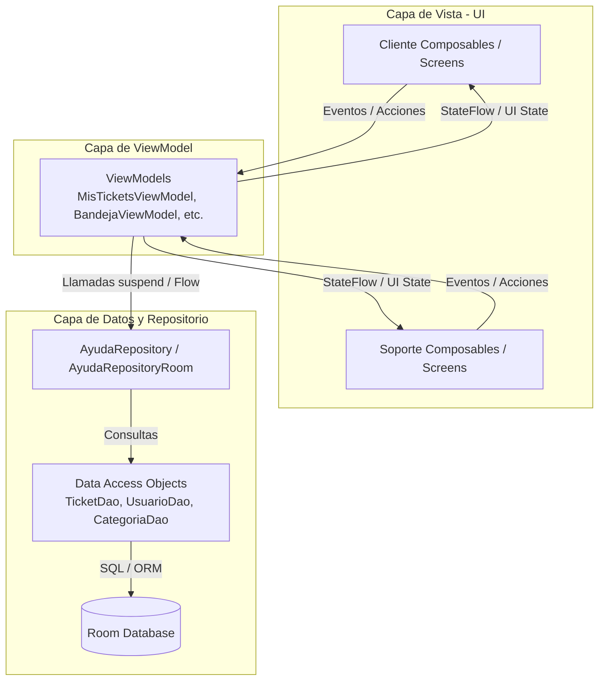

---

## Capturas de Pantalla

Las capturas están organizadas por función para mostrar cómo el cliente registra y consulta sus solicitudes, y cómo el personal de soporte las gestiona. Se muestran distintos tickets de ejemplo y pantallas en los temas claro y oscuro. Todas las imágenes se encuentran en la carpeta [`img/`](img/).

### 1. Cliente: registro y seguimiento de tickets

El recorrido comienza en **Mis tickets**, desde donde se puede consultar una solicitud o crear una nueva. Al abrir un ticket, el cliente puede revisar su avance y la conversación con soporte; una vez cerrado, puede consultar la calificación registrada.

| Consulta de solicitudes | Registro de una solicitud |
| :--- | :--- |
| **Mis tickets.** Lista de solicitudes con búsqueda por título o número, filtros por estado e indicadores de prioridad.<br><br>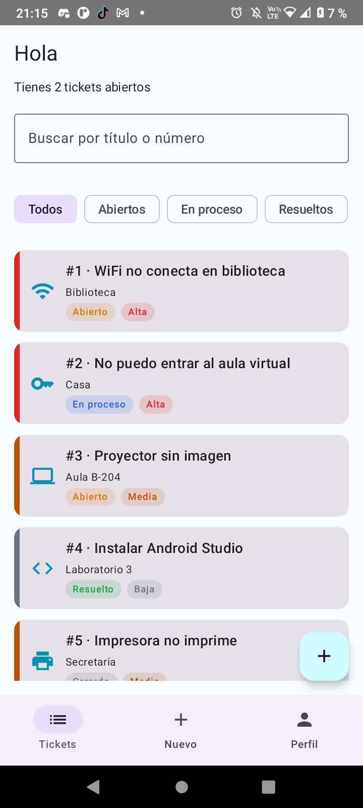 | **Nuevo ticket.** Formulario para elegir categoría y prioridad, e ingresar título, ubicación y descripción del problema.<br><br>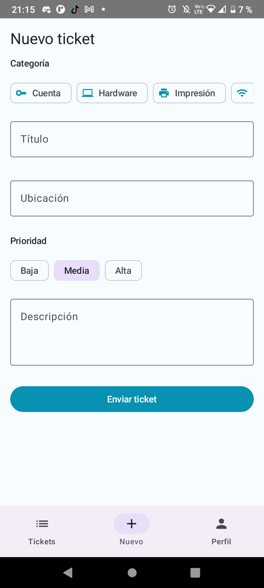 |

| Seguimiento de la atención | Resultado y calificación |
| :--- | :--- |
| **Ticket en proceso.** Detalle de una solicitud con su progreso y el intercambio de comentarios entre el cliente y soporte.<br><br>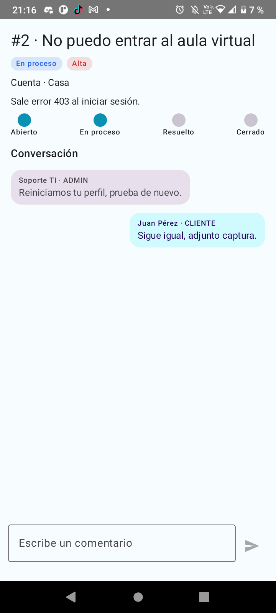 | **Ticket cerrado.** Solicitud de instalación de Android Studio finalizada, con cinco estrellas y el historial de la conversación.<br><br>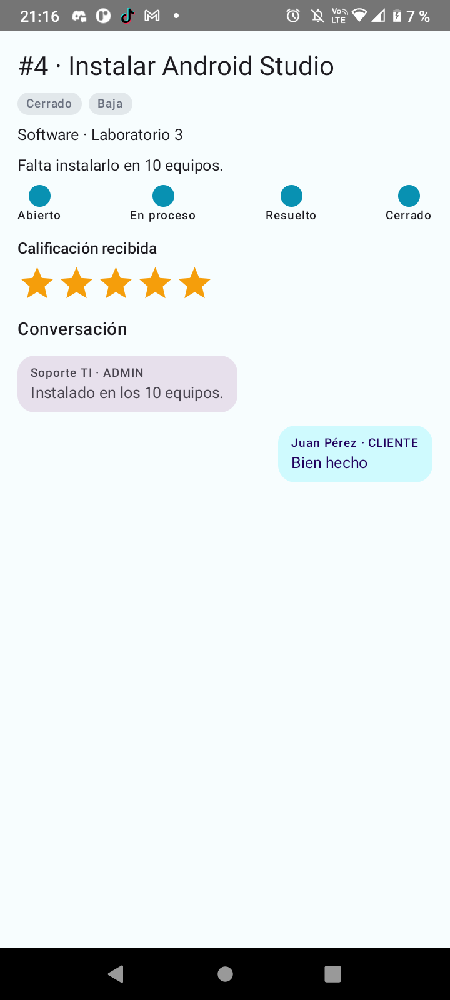 |

### 2. Soporte: supervisión y atención de solicitudes

El personal de soporte utiliza el **Panel** para revisar la carga de atención y la **Bandeja de tickets** para localizar solicitudes. Desde el detalle puede gestionar el estado y la prioridad, responder al cliente y consultar casos cerrados.

| Resumen de la atención | Bandeja de trabajo |
| :--- | :--- |
| **Panel de soporte.** Indicadores de tickets por estado, alerta de prioridad alta y gráficos de distribución por estado y categoría.<br><br>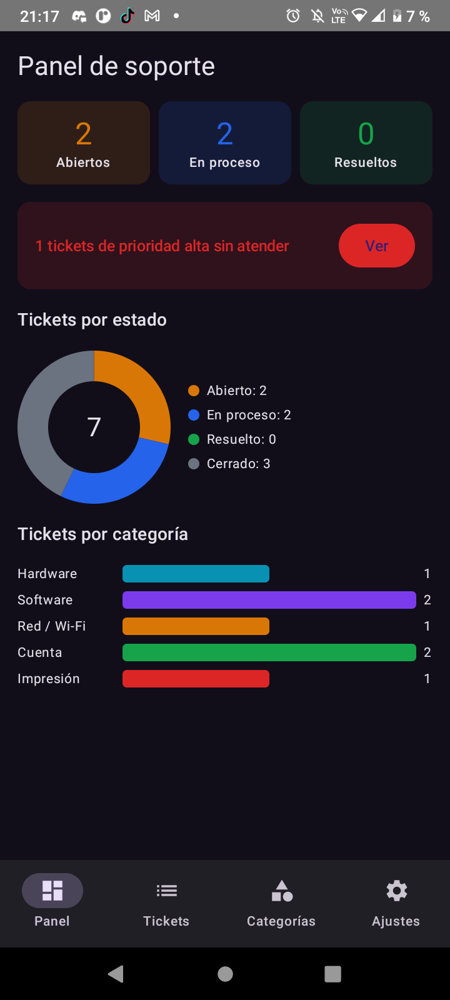 | **Bandeja de tickets.** Lista de solicitudes con el nombre del cliente, la ubicación, el estado y la prioridad, además de filtros por estado.<br><br>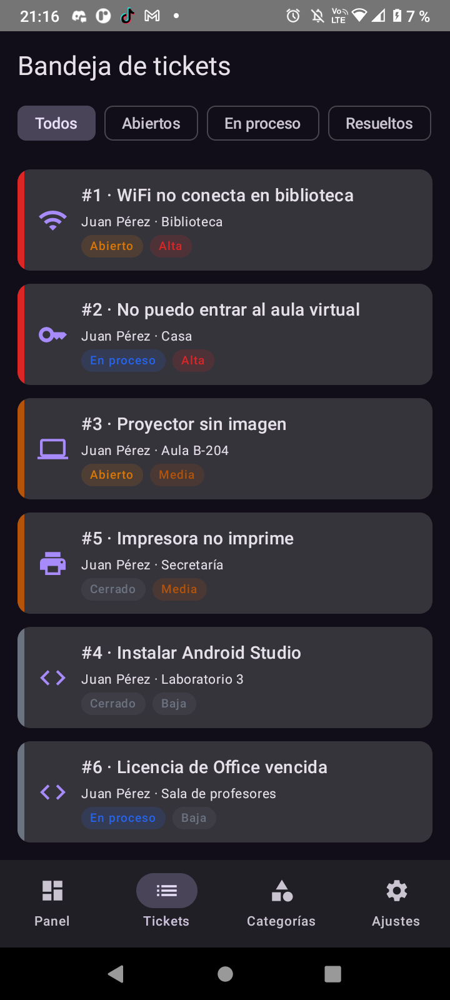 |

| Atención de un ticket | Consulta de un caso cerrado |
| :--- | :--- |
| **Atender ticket.** Vista del problema de conexión Wi-Fi con controles de estado y prioridad, conversación y botón para guardar cambios.<br><br>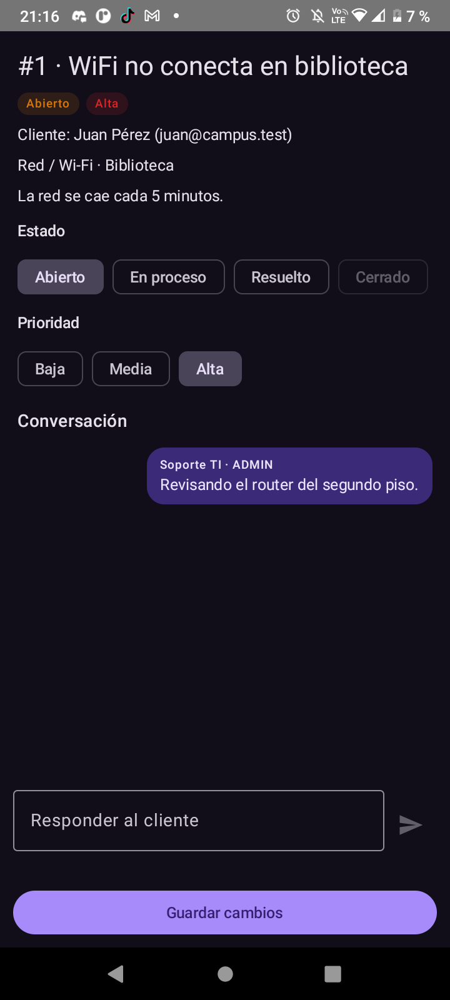 | **Ticket cerrado en soporte.** El mismo caso de instalación de Android Studio mostrado en la vista del cliente, ahora desde soporte, con el estado cerrado y los mensajes de ambas partes.<br><br>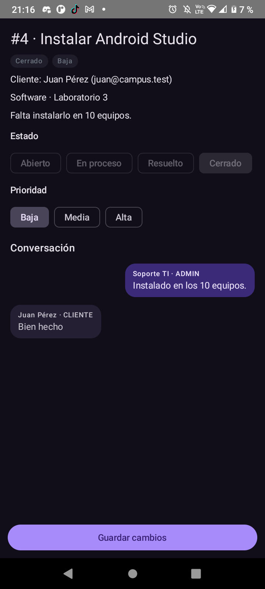 |

### 3. Soporte: gestión de categorías

La pantalla de **Categorías** permite administrar la clasificación de las solicitudes. Cada categoría muestra su nombre, icono y estado activo, junto con controles para activarla o desactivarla, editarla o eliminarla. El botón **+** permite agregar una categoría.

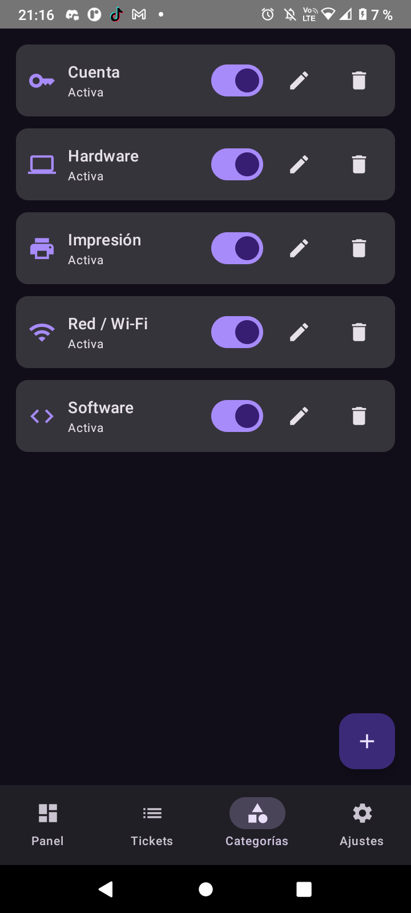

### 4. Perfil y ajustes

Estas pantallas reúnen las preferencias de cada perfil y las opciones para cambiar de rol o cerrar sesión.

| Perfil del cliente | Ajustes de soporte |
| :--- | :--- |
| **Perfil.** Datos del usuario, resumen de sus tickets y controles de modo oscuro y notificaciones, junto con las opciones para cambiar al perfil Soporte TI o cerrar sesión.<br><br>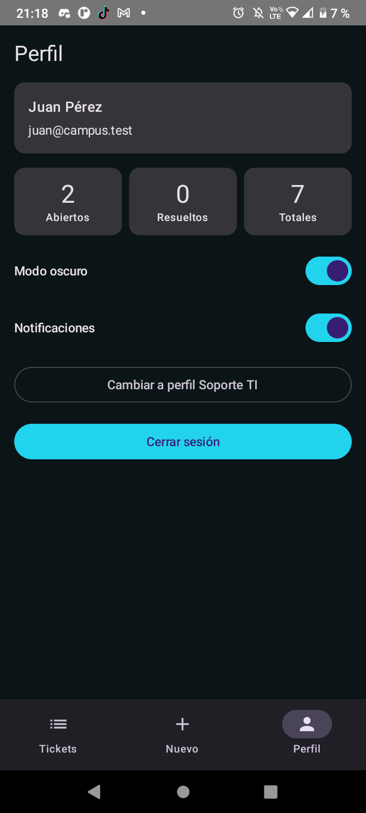 | **Ajustes.** Controles de modo oscuro, notificaciones y recepción de tickets, además del cambio al perfil Estudiante y el cierre de sesión.<br><br>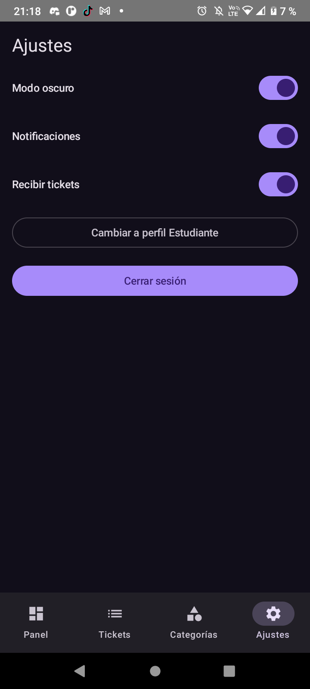 |

---

## Para Pensar

1. **¿Por qué las reglas de estado están en el ViewModel y no en el DAO ni en el Composable?**

Las reglas de estado están en el ViewModel porque ahí se controla la lógica de la aplicación. El DAO se encarga de acceder a la base de datos y el Composable de mostrar la interfaz. Esto permite mantener el código organizado y separar las responsabilidades.

2. **¿Por qué crearTicket es suspend y observarTicket es Flow?**

crearTicket es suspend porque realiza una operación en la base de datos que puede tardar y no debe bloquear la aplicación. En cambio, observarTicket utiliza Flow porque permite recibir automáticamente los cambios del ticket y actualizar la interfaz sin hacerlo manualmente.

3. **¿Qué pasaría si un ticket pudiera cerrarse sin calificación?**

Si un ticket pudiera cerrarse sin calificación, se perdería la opinión del usuario sobre la atención recibida. Además, no se cumpliría la regla de que todo ticket cerrado debe tener una calificación, lo que afectaría el seguimiento de la calidad del servicio.

4. **¿Qué debería cambiar si mañana los tickets viven en un servidor?**

Si los tickets se almacenaran en un servidor, tendría que cambiar la forma en que se obtienen y guardan los datos, utilizando una API en lugar de depender únicamente de Room. El ViewModel y la interfaz podrían mantenerse casi iguales si el acceso a los datos está bien separado.
