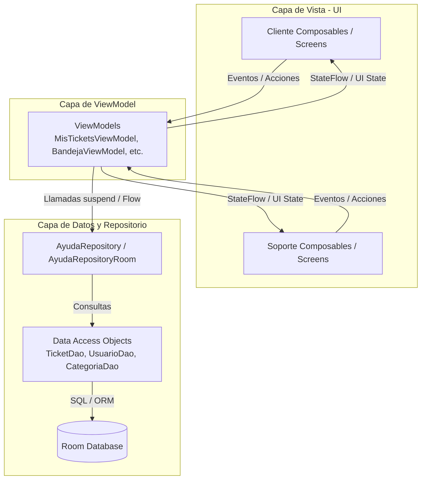

# AyudaCampus

## Descripción
**AyudaCampus** es una aplicación móvil nativa para Android desarrollada con **Jetpack Compose**, **Room Database** y la arquitectura **MVVM (Model-View-ViewModel)**. Su objetivo principal es facilitar la gestión, seguimiento y atención de solicitudes y tickets de soporte técnico dentro de la comunidad universitaria, ofreciendo perfiles diferenciados para **Clientes (Estudiantes/Docentes)** y **Personal de Soporte (Administradores)**.

---

## Árbol de Paquetes (`com.tecsup.ayudacampus`)

```text
com.tecsup.ayudacampus
│
├── AyudaApp.kt
├── MainActivity.kt
│
├── data/
│   ├── local/
│   │   ├── AyudaDatabase.kt
│   │   ├── DatosIniciales.kt
│   │   ├── dao/
│   │   │   ├── CategoriaDao.kt
│   │   │   ├── TicketDao.kt
│   │   │   └── UsuarioDao.kt
│   │   └── entity/
│   │       ├── Categoria.kt
│   │       ├── Comentario.kt
│   │       ├── Ticket.kt
│   │       └── Usuario.kt
│   ├── prefs/
│   │   └── PreferenciasStore.kt
│   └── repository/
│       ├── AyudaRepository.kt
│       └── AyudaRepositoryRoom.kt
│
├── model/
│   ├── ConteoCategoria.kt
│   ├── EstadoTicket.kt
│   ├── Prioridad.kt
│   └── Rol.kt
│
├── ui/
│   ├── cliente/
│   │   ├── DetalleTicketScreen.kt
│   │   ├── LoginScreen.kt
│   │   ├── MisTicketsScreen.kt
│   │   ├── NuevoTicketScreen.kt
│   │   ├── PerfilScreen.kt
│   │   └── SplashScreen.kt
│   ├── componentes/
│   │   ├── AppTopBar.kt
│   │   ├── AyudaButton.kt
│   │   ├── AyudaTextField.kt
│   │   ├── BurbujaComentario.kt
│   │   ├── EstadoChip.kt
│   │   ├── Estrellas.kt
│   │   ├── PrioridadChip.kt
│   │   ├── StepperTicket.kt
│   │   ├── TicketCard.kt
│   │   └── graficos/
│   │       ├── DatoGrafico.kt
│   │       ├── GraficoBarras.kt
│   │       └── GraficoDona.kt
│   ├── navigation/
│   │   ├── NavAyuda.kt
│   │   └── Rutas.kt
│   ├── soporte/
│   │   ├── AjustesScreen.kt
│   │   ├── AtenderTicketScreen.kt
│   │   ├── BandejaScreen.kt
│   │   ├── CategoriasScreen.kt
│   │   ├── FormularioCategoriaScreen.kt
│   │   └── PanelScreen.kt
│   └── theme/
│       ├── Color.kt
│       ├── Theme.kt
│       └── Type.kt
│
└── viewmodel/
    ├── AtenderViewModel.kt
    ├── AyudaViewModelFactory.kt
    ├── BandejaViewModel.kt
    ├── CategoriasViewModel.kt
    ├── MisTicketsViewModel.kt
    ├── NuevoTicketViewModel.kt
    ├── PanelViewModel.kt
    ├── SesionViewModel.kt
    └── TicketDetalleViewModel.kt
```

---

## Diagrama MVVM



---

## Capturas de Pantalla

| Perfil Cliente (Estudiante) | Perfil Soporte (Administrador) |
| :--- | :--- |
| **1. Mis Tickets / Login**<br><br> | **4. Bandeja de Tickets**<br><br> |
| **2. Nuevo Ticket**<br><br> | **5. Atender Ticket**<br><br> |
| **3. Detalle del Ticket / Calificación**<br><br> | **6. Panel Estadístico / Dashboard**<br><br> |

---

## Para Pensar

1. **¿Por qué las reglas de estado están en el ViewModel y no en el DAO ni en el Composable?**

Las reglas de estado están en el ViewModel porque ahí se controla la lógica de la aplicación. El DAO se encarga de acceder a la base de datos y el Composable de mostrar la interfaz. Esto permite mantener el código organizado y separar las responsabilidades.

2. **¿Por qué crearTicket es suspend y observarTicket es Flow?**

crearTicket es suspend porque realiza una operación en la base de datos que puede tardar y no debe bloquear la aplicación. En cambio, observarTicket utiliza Flow porque permite recibir automáticamente los cambios del ticket y actualizar la interfaz sin hacerlo manualmente.

3. **¿Qué pasaría si un ticket pudiera cerrarse sin calificación?**

Si un ticket pudiera cerrarse sin calificación, se perdería la opinión del usuario sobre la atención recibida. Además, no se cumpliría la regla de que todo ticket cerrado debe tener una calificación, lo que afectaría el seguimiento de la calidad del servicio.

4. **¿Qué debería cambiar si mañana los tickets viven en un servidor?**

Si los tickets se almacenaran en un servidor, tendría que cambiar la forma en que se obtienen y guardan los datos, utilizando una API en lugar de depender únicamente de Room. El ViewModel y la interfaz podrían mantenerse casi iguales si el acceso a los datos está bien separado.
