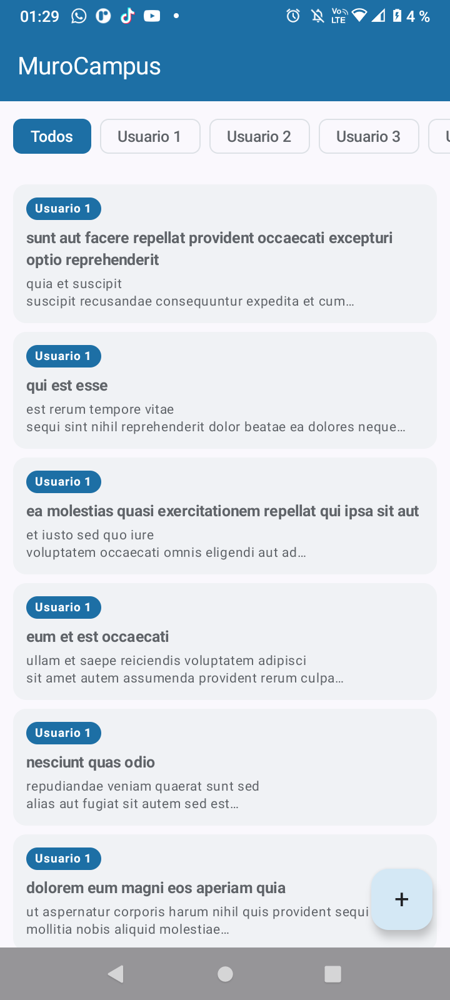
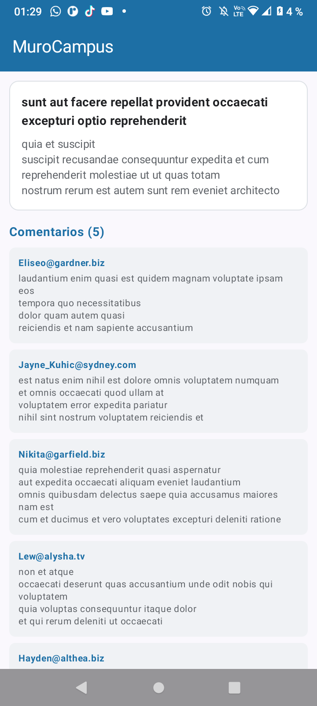
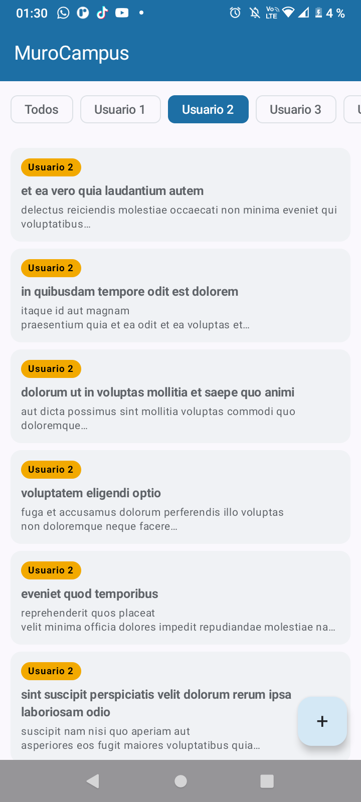
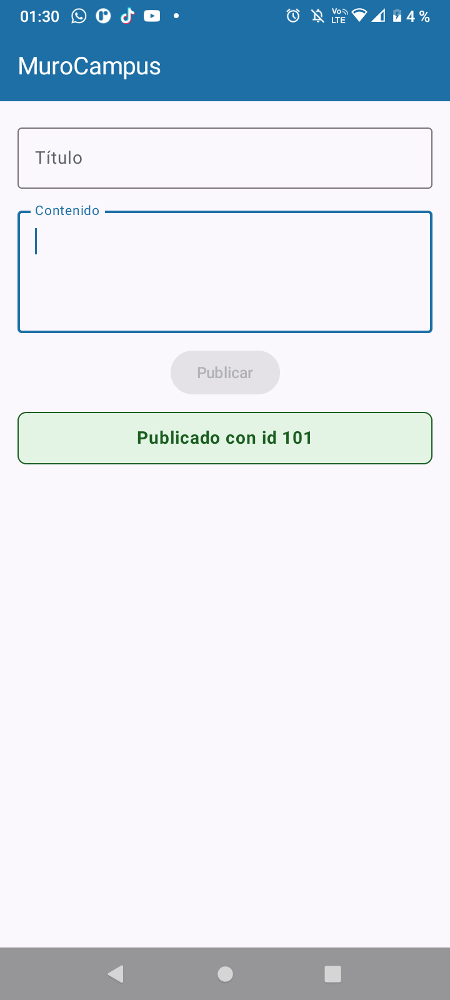
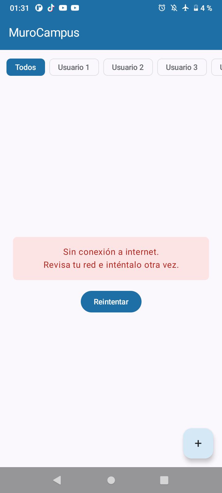

# MuroCampus

Aplicación del Laboratorio 09 (Servicios Web y plataforma REST) de Programación en Móviles. Consume el servicio REST de práctica [JSONPlaceholder](https://jsonplaceholder.typicode.com/): lista publicaciones, muestra el detalle con sus comentarios, filtra por usuario y crea una publicación nueva. Sin internet, muestra un mensaje de error con el botón **Reintentar** en lugar de cerrarse.

- **Estudiante:** Leonel Retamozo.
- **Docente:** Juan José León S.
- **Paquete:** `com.tecsup.murocampus`.
- **Rama:** `sprint-2`.
- **Tecnologías:** Kotlin, Jetpack Compose, Material 3, ViewModel, corrutinas, Retrofit, OkHttp y kotlinx.serialization.

Los textos de las publicaciones están en latín de relleno (*lorem ipsum*): son datos de práctica.

## Estructura de paquetes

```text
app/src/main/java/com/tecsup/murocampus/
├── MainActivity.kt                 navegación: lista, detalle y crear
├── model/
│   └── Modelos.kt                  Usuario, Post, Comentario, NuevoPost
├── data/
│   ├── remote/
│   │   ├── PostApi.kt              interface de Retrofit
│   │   └── RetrofitClient.kt       Retrofit + OkHttp + conversor JSON
│   └── PostRepository.kt           interface + PostRepositoryRemote
├── viewmodel/
│   ├── UiState.kt                  Cargando / Exito / Error y mensajeDe
│   ├── PostsViewModel.kt           lista, detalle, filtro y crear
│   └── PostsViewModelFactory.kt
└── ui/
    ├── Componentes.kt              TarjetaPost, Cargando, ErrorConReintento
    ├── PantallaLista.kt
    ├── PantallaDetalle.kt
    ├── PantallaCrear.kt
    └── theme/
```

## Diagrama MVVM

```text
View (PantallaLista, PantallaDetalle, PantallaCrear)
   | eventos: cargar, filtrar, publicar      ^ collectAsStateWithLifecycle()
   v                                         |
ViewModel (PostsViewModel) --- StateFlow<UiState> (Cargando / Exito / Error) --->
   | viewModelScope.launch
   v
PostRepository (interface)  <- devuelve Result<...>
   -> PostRepositoryRemote  (captura IOException, HttpException...)
   |
   v
PostApi (Retrofit) --- OkHttp ---> https://jsonplaceholder.typicode.com/
```

- La pantalla solo habla con su ViewModel y dibuja el estado con un `when`; nunca llama a la API.
- El ViewModel solo conoce la interface `PostRepository`: no usa Retrofit, `PostApi` ni `Context`.
- El Repository nunca deja escapar una excepción: la convierte en `Result.failure`. La `CancellationException` se relanza.

## API usada

| Para… | Verbo y ruta |
| --- | --- |
| Listar publicaciones | `GET posts` |
| Ver una publicación | `GET posts/{id}` |
| Ver sus comentarios | `GET posts/{id}/comments` |
| Filtrar por usuario | `GET posts?userId=2` |
| Crear una publicación | `POST posts` con JSON en el cuerpo |

## Capturas

Capturas reales tomadas en un Motorola Moto G20.

### 1. Lista de publicaciones



### 2. Detalle con comentarios



### 3. Filtro por usuario



### 4. Crear publicación



### 5. Error de conexión



## Pruebas de errores

| Prueba | Cómo provocarla | Resultado esperado | OK |
| --- | --- | --- | --- |
| Sin internet | Activar el modo avión y abrir la app | **Sin conexión a internet** y botón **Reintentar** | ✅ |
| Reintentar | Desactivar el modo avión y pulsar **Reintentar** | Carga la lista | ☐ |
| Recurso inexistente | Cambiar `posts/{id}` por `posts/9999` en `detalle` (temporal) | **Error del servidor (404)** | ☐ |
| JSON inesperado | Quitar un campo de `Post` que sí llega (temporal) | Funciona (por `ignoreUnknownKeys`); si se agrega uno que no llega, falla con **Respuesta inesperada** | ☐ |
| Cancelación | Abrir el detalle y volver rápido | No hay errores en Logcat | ☐ |
| Lista y detalle | Abrir varias publicaciones | Siempre 5 comentarios | ☐ |
| Filtro | Elegir cada usuario | Siempre 10 publicaciones | ☐ |
| Crear | Enviar una publicación | **Publicado con id 101** (en Logcat: `POST` con el JSON y respuesta 201) | ✅ |
| Código | Revisar `viewmodel/` | No hay Retrofit, `PostApi` ni `HttpException` | ☐ |

## Para pensar

### 1. ¿Qué diferencia hay entre GET y POST? ¿Por qué crear lleva @Body y porUsuario lleva @Query?

`GET` solo lee un recurso y no cambia nada en el servidor; `POST` envía datos para crear un recurso nuevo. `crear` lleva `@Body` porque la publicación nueva viaja como JSON en el cuerpo de la petición. `porUsuario` lleva `@Query` porque el usuario solo es un filtro sobre la misma lista: se agrega a la URL como `posts?userId=2`.

### 2. ¿Por qué la ruta es "posts" y no "/posts"?

Porque Retrofit une la ruta con la URL base. Si la ruta empieza con `/`, se toma como absoluta desde la raíz del dominio y reemplaza el camino de la URL base. Con `"posts"` la ruta se agrega al final de `https://jsonplaceholder.typicode.com/`, que por eso termina en `/`.

### 3. ¿Por qué el Repository devuelve Result en vez de dejar que la excepción llegue al ViewModel?

Para que el ViewModel no tenga que conocer Retrofit ni sus excepciones (`IOException`, `HttpException`). El Repository captura la falla y la devuelve como dato (`Result.failure`); el ViewModel solo decide entre `onSuccess` y `onFailure` y lo convierte en `UiState`. Así la app no se cierra por una excepción no capturada y la fuente de datos se puede cambiar sin tocar el ViewModel ni la pantalla.

### 4. ¿Qué pasa si olvidas el permiso INTERNET? ¿Y si olvidas ignoreUnknownKeys y el servidor agrega un campo nuevo?

Sin el permiso `INTERNET`, la app compila pero Android bloquea la conexión: todas las llamadas fallan con un error de red y se muestra **Sin conexión a internet** aunque el teléfono tenga internet. Sin `ignoreUnknownKeys`, kotlinx.serialization falla con `SerializationException` al encontrar un campo que no existe en la data class, y se muestra **Respuesta inesperada** aunque los datos que sí usamos lleguen bien.

### 5. ¿Por qué la pantalla de lista usa un when sobre UiState y no un if con tres variables?

Porque `UiState` es una `sealed interface`: el estado solo puede ser uno a la vez (`Cargando`, `Exito` o `Error`) y el `when` obliga a manejar los tres casos. Con tres variables separadas (`cargando`, `datos`, `error`) podrían quedar combinaciones imposibles, como cargando y con error al mismo tiempo, y sería fácil olvidar un caso.

### 6. JSONPlaceholder no guarda los POST. ¿Cómo cambiaría tu app si usaras un servicio real?

La publicación creada se guardaría de verdad, así que después del `POST` habría que actualizar la lista: agregar el `Post` que devuelve el servidor o volver a llamar a `cargar()`. Además, un servicio real normalmente pide autenticación (un token en un encabezado), valida los datos y puede responder con errores como 400 o 401, que habría que mostrar al usuario. También convendría quitar el registro BODY de OkHttp en la versión final.
