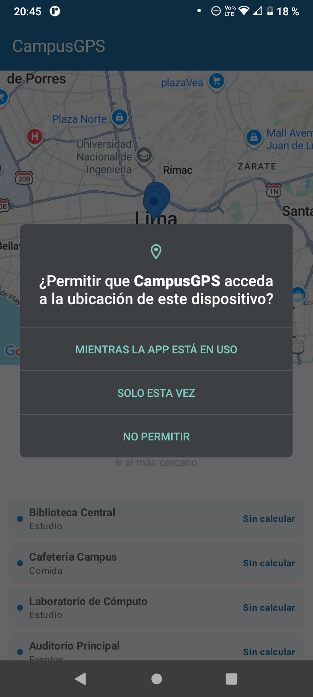
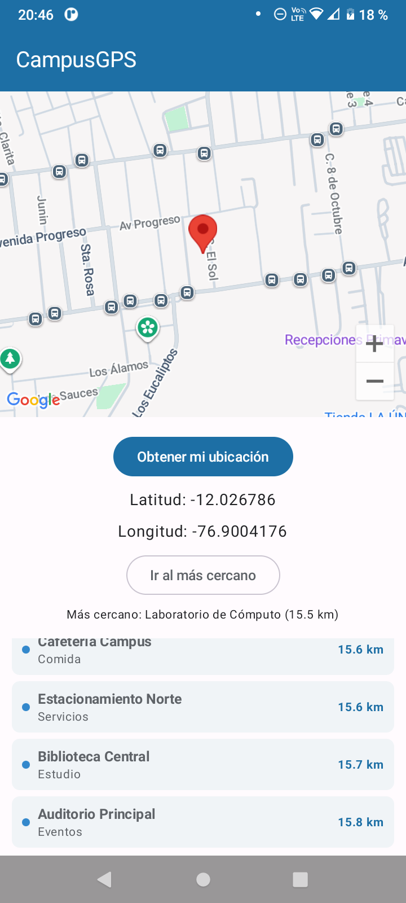
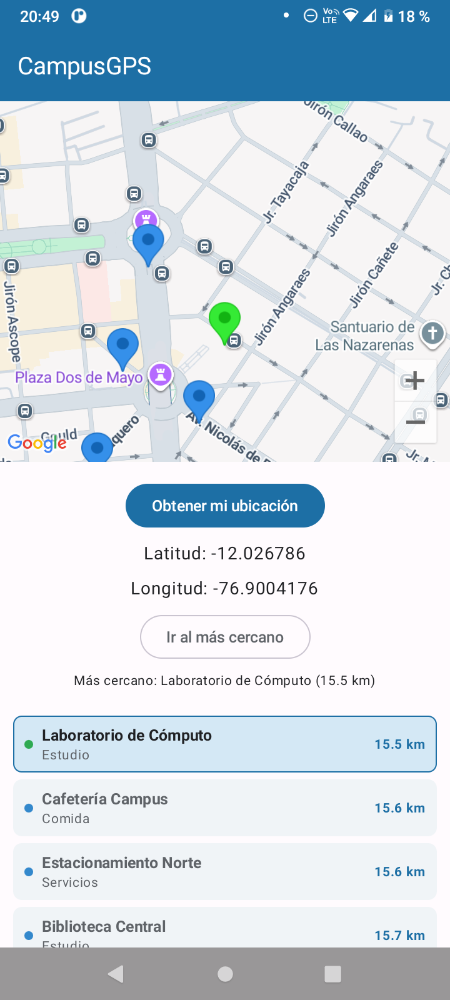
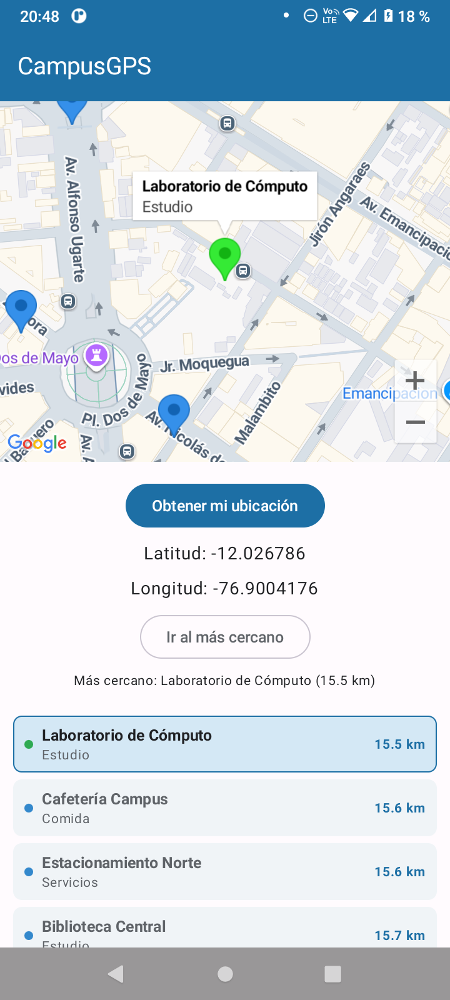
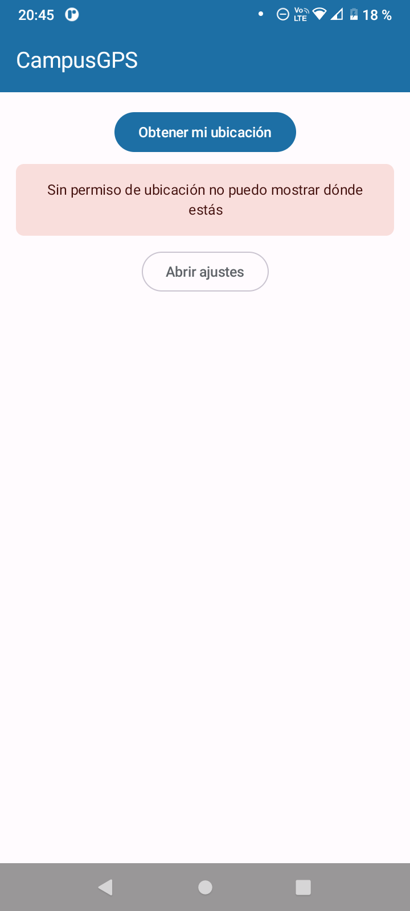

# CampusGPS

Aplicación del Laboratorio 13 de Programación en Móviles. Obtiene la ubicación del celular, la muestra en Google Maps y ordena cinco lugares ficticios del campus por su distancia al usuario.

- **Estudiante:** Leonel Retamozo.
- **Docente:** Juan León S.
- **Paquete:** `com.retamozo.campusgps`.
- **Fase 1:** rama `sprint-2`, por indicación del estudiante.
- **Tecnologías:** Kotlin, Jetpack Compose, Material 3, Google Play Services Location y Maps Compose.

El proyecto se creó siguiendo los contratos y la estructura del PDF, porque no se proporcionó el proyecto base mencionado en el enunciado. La Fase 1 está en la rama `sprint-2` y las mejoras de la Fase 2 en la rama `mejora-ia` (ver la sección **Fase 2** al final).

## Estado de la entrega

- Implementados los pasos 0 al 8: base, configuración, permisos, mapa, marcadores, distancias, selección, lugar más cercano y errores.
- Verificada la compilación desde cero y el análisis de Android Lint.
- Clave de Maps configurada únicamente en `local.properties`, excluido de Git, y APK recompilado.
- Comprobada la carga de Google Maps en un Motorola Moto G20 con Android 11 y guardadas las cinco capturas reales.
- Completadas las 12 pruebas de aceptación de la Fase 1 en el celular y la revisión local de secretos.
- Paso 9 completado: documentación y cinco capturas reales. La entrega corresponde únicamente a la Fase 1.

> Las cinco capturas de la entrega usan la ubicación real del celular. Para comprobar el punto base y el cambio de ubicación se inyectaron coordenadas de prueba mediante Google Play Services, con un auxiliar temporal de instrumentación, sin modificar el código ni las dependencias de CampusGPS. Al finalizar se desactivó la simulación y se restauraron los ajustes del celular. No se modificó la facturación.

## Estructura de paquetes

```text
app/src/main/java/com/retamozo/campusgps/
├── MainActivity.kt
├── model/
│   └── Modelos.kt
├── data/
│   ├── UbicacionRepository.kt
│   ├── UbicacionRepositoryGoogle.kt
│   ├── LugaresRepository.kt
│   └── LugaresRepositoryLocal.kt
├── util/
│   ├── Distancia.kt
│   └── Formato.kt
├── viewmodel/
│   ├── MapaViewModel.kt
│   └── CampusViewModelFactory.kt
└── ui/
    ├── PantallaMapa.kt
    ├── MapaUbicacion.kt
    ├── ListaLugares.kt
    ├── MensajeError.kt
    └── theme/
```

## Diagrama MVVM

```text
PantallaMapa
    │ eventos: buscar, seleccionar, permiso denegado
    ▼
MapaViewModel ── StateFlow ──► PantallaMapa
    │
    ├── UbicacionRepository (interface)
    │       └── UbicacionRepositoryGoogle
    │               └── FusedLocationProviderClient
    │
    └── LugaresRepository (interface)
            └── LugaresRepositoryLocal

MapaViewModel ──► util/Distancia.kt
UI            ──► util/Formato.kt
```

- La pantalla observa el estado y envía eventos al ViewModel. Los componentes del mapa, la lista y los errores reciben datos y callbacks.
- El ViewModel depende de interfaces y no recibe `Context` ni conoce Composables.
- `CampusViewModelFactory` conecta las implementaciones con el ViewModel.
- `distanciaMetros()` usa `Location.distanceBetween()` y solo se llama desde el ViewModel.
- La lista se ordena después de obtener una posición. `masCercano` se deriva de esa lista.
- Los repositorios devuelven modelos, no componentes de interfaz.

## Lugares ficticios

Son exactamente los cinco lugares del laboratorio:

| ID | Nombre | Categoría | Latitud | Longitud |
| --- | --- | --- | --- | --- |
| 1 | Biblioteca Central | Estudio | -12.0460 | -77.0435 |
| 2 | Cafetería Campus | Comida | -12.0470 | -77.0420 |
| 3 | Laboratorio de Cómputo | Estudio | -12.0455 | -77.0415 |
| 4 | Auditorio Principal | Eventos | -12.0480 | -77.0440 |
| 5 | Estacionamiento Norte | Servicios | -12.0440 | -77.0430 |

No se usa una API de lugares ni se agregan puntos reales.

## Configuración de Maps

### Requisitos

- Android Studio y JDK 21.
- Android SDK 37.
- Un emulador con Google Play o un celular con Google Play Services.
- Una clave de Google Maps con **Maps SDK for Android** habilitado.

Las cuatro dependencias del laboratorio están declaradas en `gradle/libs.versions.toml`: Location `21.3.0`, corrutinas Play Services `1.8.1`, Maps Compose `8.4.0` y ViewModel Compose `2.8.7`. También están las dependencias básicas de una aplicación Compose.

### Clave y restricciones

1. En Google Cloud, habilitar **Maps SDK for Android**.
2. Crear una clave y restringirla a una aplicación Android:
   - Paquete: `com.retamozo.campusgps`.
   - SHA-1: obtenerla con este comando desde `LAB13/CampusGPS`:

   ```powershell
   .\gradlew.bat signingReport
   ```

3. Restringir el uso de la clave a **Maps SDK for Android**.
4. Crear o editar `local.properties`, en la raíz de `CampusGPS`. Mantener `sdk.dir` y agregar la propiedad `MAPS_API_KEY` con el valor de la clave.
5. Sincronizar Gradle y volver a compilar.

Si Google Cloud solicita facturación, consultarlo con el docente antes de continuar.

En este equipo, la SHA-1 del certificado de depuración es:

```text
DA:19:D8:ED:CC:43:12:4C:DE:74:1C:62:ED:CD:06:96:1F:49:D6:03
```

`app/build.gradle.kts` lee la propiedad y la pasa al Manifest mediante `manifestPlaceholders["MAPS_API_KEY"]`. En el Manifest solo está la referencia `${MAPS_API_KEY}`, nunca el valor real.

**No subir `local.properties` a GitHub ni pegar la clave en un prompt.** El archivo está excluido por `.gitignore`. Si se expone una clave, revocarla y crear otra con las restricciones correspondientes.

## Compilación

Abrir `LAB13/CampusGPS` como proyecto en Android Studio o ejecutar desde esa carpeta:

```powershell
.\gradlew.bat clean assembleDebug lintDebug --console=plain
```

APK:

```text
app/build/outputs/apk/debug/app-debug.apk
```

El código compila sin una clave para permitir preparar el proyecto, pero **la clave válida es obligatoria para ejecutar el mapa**.

## Uso

1. En el emulador, abrir **Extended controls → Location**.
2. Establecer la latitud `-12.0464` y la longitud `-77.0428`.
3. Abrir CampusGPS y pulsar **Obtener mi ubicación**.
4. Aceptar ubicación precisa o aproximada.
5. Revisar las coordenadas, el marcador rojo **Estás aquí** y la lista ordenada por distancia.
6. Tocar una tarjeta para resaltarla y mover la cámara al lugar, con zoom 17.
7. Pulsar **Ir al más cercano** para seleccionar el lugar verde.
8. Cambiar la ubicación del emulador y volver a buscar para actualizar las distancias.

Antes de calcular, las tarjetas muestran **Sin calcular** y el botón al más cercano está deshabilitado. Los lugares son azules; después de calcular, el más cercano se muestra en verde.

### Errores

| Problema | Mensaje o acción |
| --- | --- |
| Permiso denegado | Mensaje de permiso y botón **Abrir ajustes** |
| Ubicación apagada o no disponible | **Activa el GPS e intenta de nuevo** y botón **Reintentar** |
| Sin Google Play Services | Mensaje explicativo, sin botón Reintentar |
| Otro error al obtener ubicación | Mensaje explicativo y botón **Reintentar** |

## Pruebas de aceptación

Comprobadas en un Motorola Moto G20 con Android 11, el 17 de noviembre de 2026. El diálogo y el rechazo de permisos se comprobaron durante la toma de capturas, tras reiniciar únicamente los permisos de CampusGPS; las pruebas restantes se completaron después. La revisión de secretos se realizó en el repositorio.

- [x] Primera apertura sin permisos: al pulsar el botón aparece el cuadro de permiso.
- [x] Aceptar: se ven latitud, longitud y el marcador **Estás aquí**.
- [x] Negar: aparece el error con **Abrir ajustes** y la app no se cierra.
- [x] Punto base: se ven los cinco lugares del campus cerca del usuario.
- [x] Tocar un marcador: se muestran su nombre y categoría.
- [x] La lista queda ordenada de menor a mayor distancia, con m o km.
- [x] Tocar una tarjeta mueve la cámara y resalta la tarjeta.
- [x] **Ir al más cercano** está deshabilitado antes de buscar y después selecciona el lugar verde.
- [x] Cambiar de ubicación y volver a buscar actualiza las distancias, el orden y el marcador verde.
- [x] Apagar ubicación muestra el mensaje del GPS y **Reintentar**.
- [x] Rotar conserva la ubicación y la lista.
- [x] `local.properties` está ignorado, no está versionado y no hay una clave de Maps en los archivos versionados de este proyecto.

### Verificación realizada

- `clean assembleDebug lintDebug`: correcto.
- Recompilación con la clave configurada (`assembleDebug lintDebug`): correcta.
- Android Lint: sin errores. Quedan avisos de versiones más nuevas de dependencias y de configuración de respaldo.
- Google Maps carga en el celular Motorola Moto G20 con Android 11.
- Se capturaron el permiso de ubicación, el marcador propio, los cinco lugares, la lista ordenada con selección y el error por permiso denegado.
- El permiso de ubicación quedó concedido al terminar las capturas.
- La clave está guardada solo en el archivo local ignorado.
- Verificación final con `assembleDebug lintDebug`: correcta.

### Resultados de las pruebas pendientes

| Prueba | Resultado observado |
| --- | --- |
| Punto base `-12.0464, -77.0428` | Biblioteca Central: 88 m; Cafetería Campus: 110 m; Laboratorio de Cómputo: 173 m; Auditorio Principal: 220 m; Estacionamiento Norte: 266 m. Los cinco elementos quedaron ordenados. |
| Selección | La tarjeta mostró el borde azul y la cámara se centró en su marcador. Al tocar el marcador de Biblioteca Central se mostraron su nombre y la categoría Estudio. |
| Más cercano | El botón estaba deshabilitado antes de buscar. Después seleccionó Biblioteca Central, con su marcador verde. |
| Cambio a `-12.0438, -77.0431` | Cambiaron las distancias y el orden; Estacionamiento Norte pasó a ser el más cercano y su marcador se mostró verde. |
| GPS apagado | Aparecieron **Activa el GPS e intenta de nuevo** y **Reintentar**. Al activar la ubicación y reintentar, la búsqueda volvió a funcionar. |
| Rotación | Se giró realmente a horizontal y se volvió a vertical, sin volver a buscar. Se conservaron exactamente las coordenadas y las cinco distancias. |

En horizontal, en este celular el mapa queda sin altura por el espacio ocupado por los controles y la lista fija del enunciado; al volver a vertical reaparece y los datos se conservan. No se rediseñó la interfaz del laboratorio.

El auxiliar de instrumentación se usó solo para las pruebas, fuera del repositorio; no forma parte del APK entregado ni agrega librerías al proyecto.

## Capturas requeridas

Capturas reales tomadas en un Motorola Moto G20 con Android 11. Las distancias corresponden a la ubicación real del celular respecto de los cinco lugares ficticios del laboratorio. No se usaron las ilustraciones del PDF como evidencia.

### 1. Permiso de ubicación



### 2. Mapa con ubicación propia



### 3. Marcadores de los cinco lugares



### 4. Lista ordenada y selección



### 5. Estado de error



## Para pensar

### 1. ¿Por qué FusedLocationProviderClient está dentro del Repository y no en el ViewModel?

Porque depende de Google Play Services y de un `Context`. La implementación del repositorio se ocupa de esos detalles. El ViewModel solo conoce la interface `UbicacionRepository`, por lo que puede manejar el estado sin depender de Android ni de Google.

### 2. ¿Qué diferencia hay entre el permiso de ubicación y la clave de Maps?

El permiso lo concede el usuario mediante Android y permite obtener la posición del dispositivo. La clave autoriza el uso del mapa para nuestra aplicación. Sin permiso se muestra el error con acceso a ajustes; sin una clave válida el mapa no puede funcionar. Son servicios distintos.

### 3. ¿Por qué la clave va en local.properties? ¿Qué harías si se subiera por error?

`local.properties` está excluido por Git. Gradle lee la clave desde ese archivo, evitando escribir su valor en el código o en el Manifest versionado. Si se expusiera, habría que revocarla, crear otra, revisar las restricciones y retirar el valor expuesto del repositorio. Borrarlo solamente del último archivo no invalida la clave ni lo elimina del historial.

### 4. ¿Dónde calculas la distancia y por qué no en el Composable?

En `util/Distancia.kt`, mediante `Location.distanceBetween()`. El ViewModel llama a esa función desde `actualizarDistancias()` cuando obtiene una ubicación, ordena la lista y publica el resultado. La pantalla solo muestra y formatea esos valores; no calcula ni ordena distancias.

### 5. ¿Qué pasa si el usuario niega el permiso dos veces?

Android puede dejar de mostrar el diálogo de permiso. Si la solicitud vuelve sin un permiso concedido, el ViewModel publica un error `SIN_PERMISO`. La pantalla muestra **Abrir ajustes**, que abre los ajustes de esta aplicación con `ACTION_APPLICATION_DETAILS_SETTINGS`. Desde allí el usuario puede concederlo manualmente; después debe volver y pulsar **Obtener mi ubicación**.

## Fase 2 · Mejoras (rama `mejora-ia`)

Se implementaron las seis mejoras de la guía. El detalle de los prompts y de las decisiones está en [PROMPTS.md](PROMPTS.md).

| Mejora | Qué hace | Capas que cambian |
| --- | --- | --- |
| Filtrar por categoría | Chips Todas, Estudio, Comida, Eventos y Servicios. Filtran el mapa y la lista, y el más cercano se busca entre los visibles. | ViewModel + View |
| Radio de cercanía | Selector Sin radio, 100, 200 o 500 m. Dibuja un `Circle` alrededor de la posición y marca en la lista los lugares que están dentro. | ViewModel + View |
| Punto azul nativo | `isMyLocationEnabled` y el botón de mi ubicación del mapa, solo con el permiso concedido. | View |
| Seguimiento en vivo | `requestLocationUpdates` convertido en `Flow` con `callbackFlow`. Se controla con el botón **Iniciar en vivo / Detener en vivo** de la barra superior. | Repository + ViewModel + View |
| Último lugar visitado | Guarda en DataStore el último lugar seleccionado. Al abrir la app lo vuelve a seleccionar y muestra **Último visitado**. | Repository + ViewModel |
| Mapa en modo oscuro | Con el tema oscuro del sistema, la app usa colores oscuros y el mapa usa `res/raw/mapa_oscuro.json`. | View |

Archivos nuevos:

```text
data/PreferenciasRepository.kt
data/PreferenciasRepositoryDataStore.kt
ui/FiltroCategorias.kt
ui/SelectorRadio.kt
res/raw/mapa_oscuro.json
res/values-night/colors.xml
```

Dependencia nueva: `androidx.datastore:datastore-preferences` (`1.1.1`), declarada en `gradle/libs.versions.toml`.

### Cómo probar

1. **Filtro:** buscar la ubicación y tocar **Comida**. Solo queda Cafetería Campus, en verde.
2. **Radio:** con el punto base, elegir **100 m**. Aparece el círculo y Biblioteca Central (88 m) se marca como **Dentro del radio**.
3. **Punto azul:** con el permiso concedido, se ven el punto azul y el botón de mi ubicación del mapa.
4. **En vivo:** pulsar **Iniciar en vivo** y cambiar la ubicación del emulador. Las distancias y el lugar verde se actualizan sin volver a pulsar el botón.
5. **Último visitado:** tocar una tarjeta, cerrar la app y volver a abrirla. La tarjeta aparece seleccionada y el mapa va hasta ese lugar.
6. **Modo oscuro:** activar el tema oscuro del sistema y abrir la app. El mapa y la interfaz se ven oscuros.
