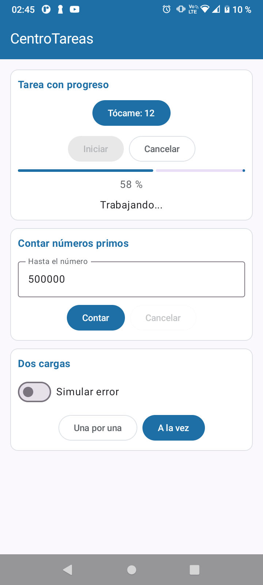
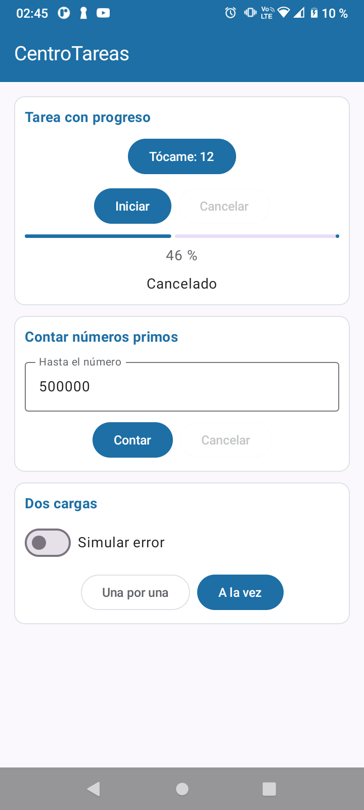
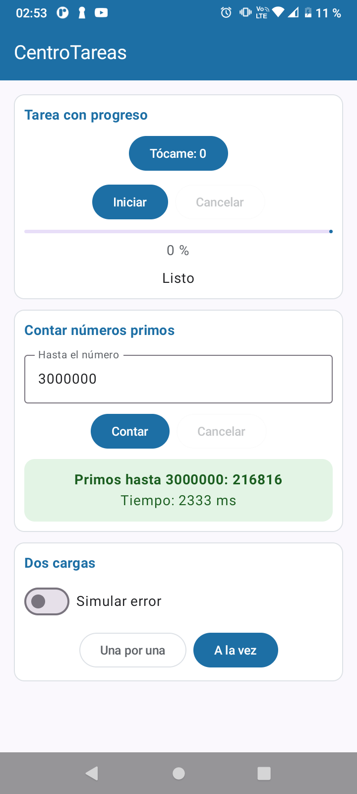
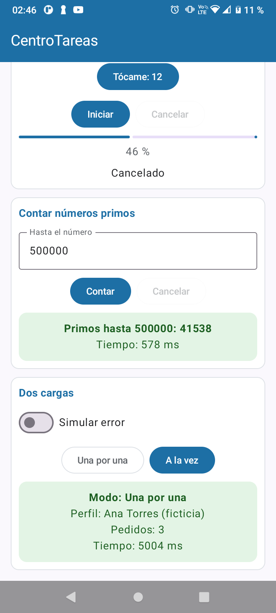
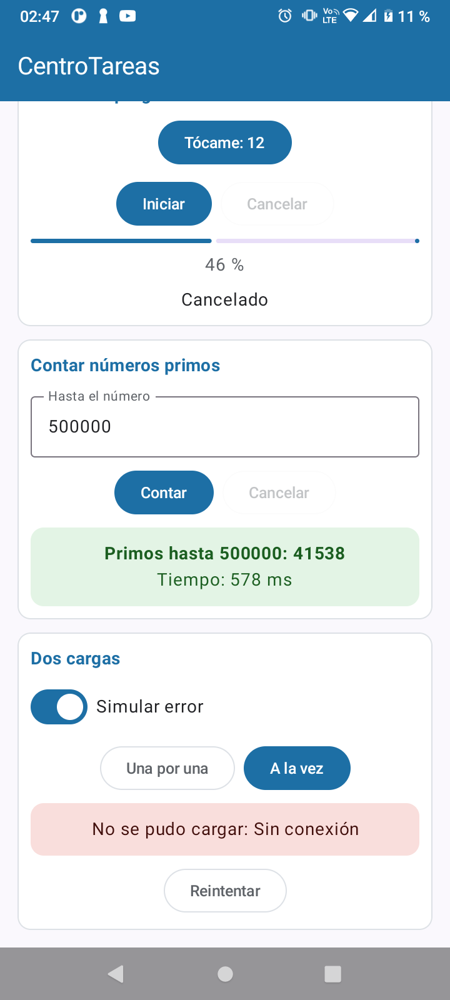

# CentroTareas

Aplicación del Laboratorio 14 de Programación en Móviles. Ejecuta tres tareas que tardan (una tarea con barra de progreso, un cálculo de números primos y dos cargas de datos simuladas) con corrutinas, sin bloquear nunca el hilo principal.

- **Estudiante:** Leonel Retamozo.
- **Docente:** Juan León S.
- **Paquete:** `com.retamozo.centrotareas`.
- **Rama:** `sprint-2`.
- **Tecnologías:** Kotlin, Jetpack Compose, Material 3, corrutinas y ViewModel.

Todos los datos son ficticios. No se usa `GlobalScope`, `runBlocking` ni `Thread.sleep` en el código final.

## Estructura de paquetes

```text
app/src/main/java/com/retamozo/centrotareas/
├── MainActivity.kt
├── model/
│   └── Estados.kt                 PrimosUi, CargaUi
├── data/
│   ├── TareasRepository.kt        interface
│   └── TareasRepositoryLocal.kt   cargas simuladas y contarPrimos
├── viewmodel/
│   ├── TareasViewModel.kt
│   └── TareasViewModelFactory.kt
└── ui/
    ├── PantallaTareas.kt
    └── theme/
```

## Diagrama MVVM

```text
View (PantallaTareas)
   | eventos: botones              ^ collectAsState()
   v                               |
ViewModel (TareasViewModel) --- StateFlow --->
   | viewModelScope.launch { ... }
   v
TareasRepository (interface) ---> TareasRepositoryLocal
                                   (cargas simuladas y contar primos)
```

- La pantalla solo muestra el estado y avisa los eventos; no lanza corrutinas ni usa `Thread`.
- El ViewModel lanza las corrutinas con `viewModelScope`, no recibe `Context` y no bloquea el hilo principal.
- El Repository no conoce la interfaz. `contarPrimos` usa `withContext(Dispatchers.Default)` y las cargas se simulan con `delay`.

## Observación del Paso 1

Al pulsar **Tarea larga (MAL)** y enseguida **Tócame**, la pantalla deja de responder durante 4 segundos: el contador no suma, los botones no reaccionan y nada se vuelve a dibujar. Cuando termina la espera, los toques pendientes se procesan de golpe y el texto pasa directamente a **Terminó**.

**Trabajando...** no llega a verse porque `tareaLargaMala()` corre en el hilo principal, que es el mismo que dibuja la pantalla. El valor cambia a «Trabajando...», pero `Thread.sleep(4000)` bloquea el hilo antes de que Compose pueda dibujar un nuevo cuadro. Cuando el hilo se libera, el valor ya es «Terminó», así que solo se dibuja el estado final.

Si la espera fuera de 10 segundos, Android detectaría que la app no responde a los toques (pasados unos 5 segundos) y mostraría el diálogo **ANR: «CentroTareas no responde»**, con las opciones de esperar o cerrar la app.

## Capturas

Capturas reales tomadas en un Motorola Moto G20 con Android 11.

### 1. Tarea con progreso



### 2. Tarea cancelada



### 3. Primos



### 4. Una por una contra a la vez

| Una por una | A la vez |
| --- | --- |
|  |  |

### 5. Error



## Valor por defecto de los primos

Con 500 000 el cálculo tardó 578 ms en el Moto G20 (41 538 primos) y con 1 500 000, 1044 ms (114 155 primos). Como la guía pide que tarde entre 2 y 5 segundos, el valor por defecto quedó en **3 000 000**: 216 816 primos en 2333 ms.

## Pruebas de aceptación

| Prueba | Resultado observado | OK |
| --- | --- | --- |
| Tarea larga: tocar Tócame mientras trabaja | El contador sigue sumando | ✅ |
| Logcat con filtro HILO | Pendiente de revisar en Logcat: `main` antes y después, `DefaultDispatcher-worker` dentro | ☐ |
| Iniciar la tarea con progreso | La barra avanza de 0 a 100 % en unos 4 s y termina en **Terminó** | ✅ |
| Cancelar a mitad | La barra se detiene en 46 %, dice **Cancelado** y se puede iniciar otra vez | ✅ |
| Pulsar Iniciar dos veces seguidas | Iniciar queda deshabilitado mientras corre | ✅ |
| Primos hasta 1000 | Pendiente de comprobar en el celular (resultado esperado: 168) | ☐ |
| Primos con N grande | Con 3 000 000 la pantalla no se congela (Tócame suma) y Cancelar deja el estado en **Cancelado** | ✅ |
| Una por una | 5004 ms, Ana Torres (ficticia) y 3 pedidos | ✅ |
| A la vez | 3003 ms, Ana Torres (ficticia) y 3 pedidos | ✅ |
| Error simulado + Reintentar | Recuadro rojo «No se pudo cargar: Sin conexión»; al desactivar el interruptor y reintentar, recuadro verde | ✅ |
| Rotar la pantalla durante la tarea | Pendiente de comprobar | ☐ |
| Revisar el código | `git grep` no encuentra `GlobalScope`, `runBlocking` ni `Thread.sleep` en los archivos `.kt` | ✅ |

También se comprobaron 500 000 → 41 538 y 1 500 000 → 114 155 primos.

## Para pensar

### 1. ¿Por qué no se veía Trabajando... en el Paso 1?

Porque `Thread.sleep(4000)` bloqueaba el hilo principal, que es el que dibuja la pantalla. El mensaje cambiaba a «Trabajando...», pero Compose no podía dibujar un nuevo cuadro hasta que terminara la espera; para entonces el mensaje ya era «Terminó».

### 2. ¿Qué diferencia hay entre Thread.sleep y delay?

`Thread.sleep` bloquea el hilo completo: nadie más puede usarlo durante la espera. `delay` es una función `suspend`: suspende solo la corrutina y libera el hilo para otro trabajo, por ejemplo, dibujar la pantalla y atender toques. Además, `delay` revisa la cancelación.

### 3. ¿Por qué Dispatchers.Default para los primos y Dispatchers.IO para la red?

Contar primos usa mucho procesador; `Dispatchers.Default` tiene tantos hilos como núcleos y está pensado para cálculos. La red y el disco pasan casi todo el tiempo esperando una respuesta; `Dispatchers.IO` tiene un grupo de hilos más grande para que muchas esperas no ocupen los hilos de cálculo.

### 4. ¿Qué pasaría con la corrutina si el usuario cierra la pantalla? ¿Qué papel cumple viewModelScope?

`viewModelScope` está atado al ViewModel. Si se cierra la pantalla definitivamente, el ViewModel se destruye (`onCleared`) y sus corrutinas se cancelan solas, sin seguir gastando recursos ni actualizar una pantalla que ya no existe. Al rotar, el ViewModel sobrevive, así que la tarea continúa.

### 5. ¿Por qué async tarda 3 s y no 5 s? ¿Qué pasa si una de las dos cargas falla?

Con `async` las dos cargas empiezan al mismo tiempo, así que el total es el de la más lenta: máximo(2 s, 3 s) ≈ 3 s. Una por una se suman: 2 s + 3 s ≈ 5 s. Si una carga falla dentro de `coroutineScope`, la otra se cancela y el error sale de `coroutineScope`; el `catch` lo convierte en `Error("No se pudo cargar: ...")` y se muestra **Reintentar**.
