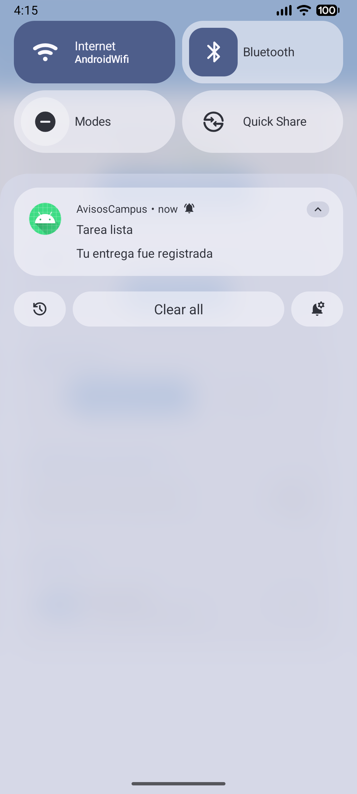
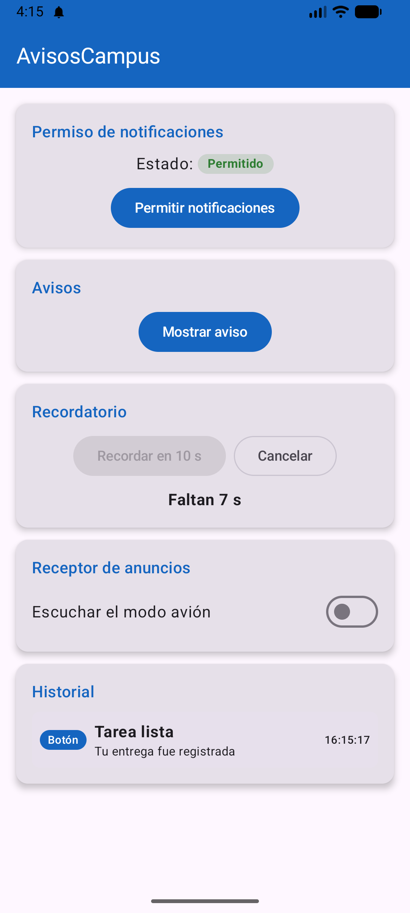
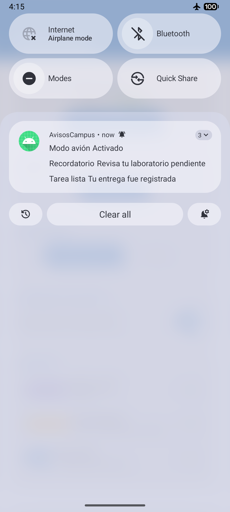
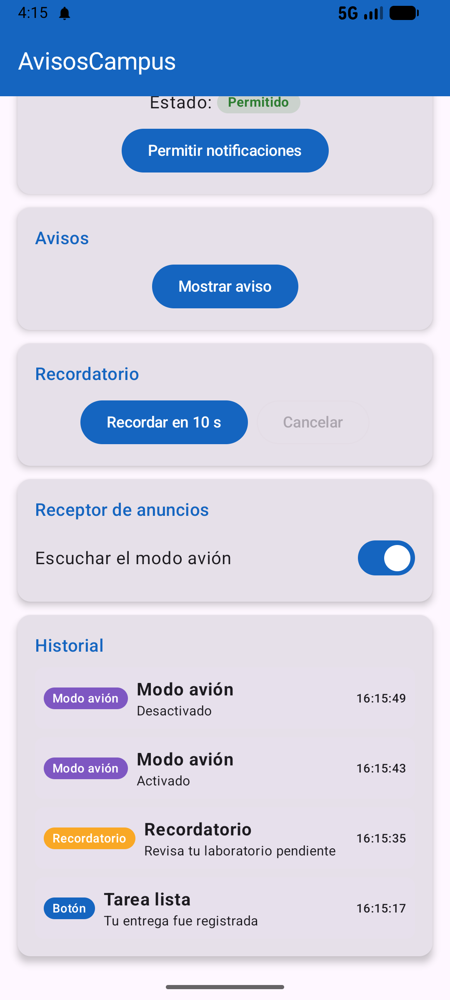
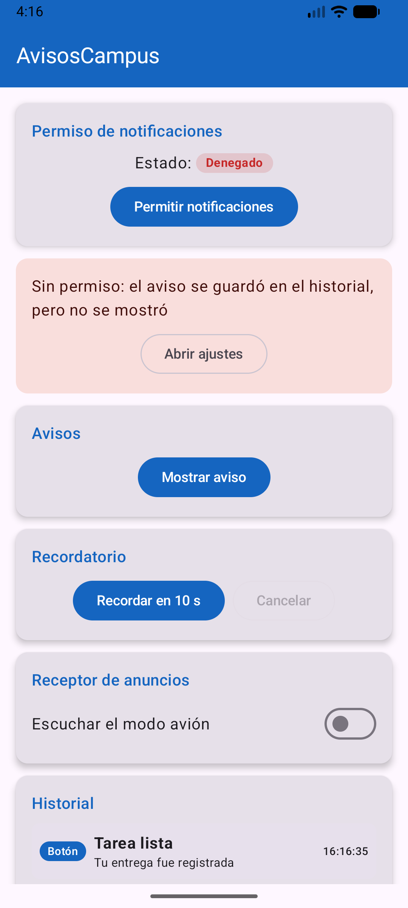

# AvisosCampus

Aplicación del Laboratorio 15 de Programación en Móviles. Muestra notificaciones y escucha lo que pasa en el celular: con un botón muestra un aviso, con otro programa un recordatorio que llega a los 10 segundos y, si se activa el switch, avisa cuando el usuario activa o desactiva el modo avión. Todos los avisos quedan anotados en un historial.

- **Estudiante:** Leonel Retamozo.
- **Docente:** Juan León S.
- **Paquete:** `com.retamozo.avisoscampus`.
- **Rama:** `sprint-2` (Fase 1).
- **Tecnologías:** Kotlin, Jetpack Compose y Material 3 (sin XML), notificaciones locales y `BroadcastReceiver`.
- **Patrón:** MVVM + Repository (interface).

Todos los datos son ficticios. No se usa internet ni claves: todo es local.

## Estructura de paquetes

```text
app/src/main/java/com/retamozo/avisoscampus/
├── AvisosApp.kt                  Application: crea el canal
├── MainActivity.kt
├── model/
│   └── Modelos.kt                Aviso, Origen, PermisoUi
├── data/
│   └── AvisosRepository.kt       interface + AvisosRepositoryMemoria
├── notificacion/
│   └── Notificador.kt            canal, permiso y mostrar
├── receiver/
│   └── ModoAvionReceiver.kt
├── viewmodel/
│   ├── AvisosViewModel.kt
│   └── AvisosViewModelFactory.kt
└── ui/
    ├── PantallaAvisos.kt         las tarjetas
    ├── HistorialAvisos.kt
    └── theme/
```

## Diagrama MVVM

```text
View (PantallaAvisos)
   | eventos: botones, switch          ^ collectAsState()
   v                                   |
ViewModel (AvisosViewModel) --- StateFlow (avisos, permiso, faltan...) --->
   | registra el aviso                 | emite: eventos (SharedFlow<Aviso>)
   v                                   v
AvisosRepository (interface)        View recibe el evento y llama a
   -> AvisosRepositoryMemoria       Notificador.mostrar(context, aviso)
```

- **View (`ui/`):** solo conoce a su ViewModel y al `Notificador`. No decide qué se avisa ni guarda el historial.
- **ViewModel:** solo conoce la interface del Repository. No recibe `Context` ni muestra notificaciones.
- **Repository:** no conoce nada de la UI ni usa `Context`.
- **Notificador:** habla con el sistema (canal y `NotificationManager`). No guarda estado de la app.

El ViewModel decide qué avisar y lo anota en el Repository. Después emite un evento. La pantalla lo recibe y, como sí tiene `Context`, llama al `Notificador`.

## Capturas

Capturas reales tomadas en el emulador Medium Phone API 36.1 (Android 16).

### 1. Notificación en el panel



### 2. Recordatorio



### 3. Modo avión



### 4. Historial



### 5. Permiso denegado



## Pruebas de aceptación

| Prueba | Resultado esperado | OK |
| --- | --- | --- |
| Abrir Ajustes → Apps → AvisosCampus → Notificaciones | Existe el canal **Avisos** | ✅ |
| Pulsar **Permitir notificaciones** | Aparece el cuadro de Android y la etiqueta cambia | ✅ |
| Pulsar **Mostrar aviso** | Aparece la notificación **Tarea lista** | ✅ |
| Pulsar **Mostrar aviso** dos veces | Aparecen dos notificaciones distintas | ✅ |
| Tocar la notificación | Se abre la app y la notificación desaparece | ✅ |
| Recordar en 10 s | Cuenta regresiva y aviso al llegar a 0 | ✅ |
| Recordar y minimizar la app | El aviso llega igual | ✅ |
| Recordar y cancelar | No llega ningún aviso | ✅ |
| Switch activado y cambiar el modo avión | Aviso **Activado** y luego **Desactivado** | ✅ |
| Switch desactivado y cambiar el modo avión | No hay aviso | ✅ |
| Permiso denegado y **Mostrar aviso** | Mensaje de error, aviso en el historial y la app no se cierra | ✅ |
| Rotar la pantalla durante el recordatorio | La cuenta regresiva continúa | ✅ |
| Revisar el código | No hay `Context` en el `viewmodel/` y todo receptor registrado se quita en `onDispose` | ✅ |

## Para pensar

### 1. ¿Por qué una notificación necesita un canal y un permiso? ¿Qué pasa si falta cada uno?

Desde Android 8 cada notificación debe pertenecer a un **canal**. El canal agrupa avisos del mismo tipo y le permite al usuario decidir, desde Ajustes, cuáles quiere recibir y con qué importancia. Si el canal no existe, Android descarta la notificación y no aparece nada.

Desde Android 13 el **permiso** `POST_NOTIFICATIONS` le da al usuario el control de si la app puede notificarle. Si falta, la notificación tampoco se muestra. Por eso `Notificador.mostrar` revisa el permiso primero y devuelve `false` sin lanzar error.

### 2. ¿Por qué el ViewModel emite un evento y no muestra la notificación él mismo?

Porque mostrar una notificación necesita `Context`, y el ViewModel no debe tenerlo: vive más que la pantalla (por ejemplo, al rotar) y guardar un `Context` podría filtrar memoria. Además, así el ViewModel se puede probar sin Android.

El ViewModel solo decide qué avisar, lo registra en el Repository y emite un evento en el `SharedFlow`. La pantalla, que sí tiene `Context`, recibe el evento y llama al `Notificador`.

### 3. ¿Qué pasa si usas el mismo id en dos notificaciones?

La segunda **reemplaza** a la primera: en el panel solo queda una. Por eso se usa el `id` del aviso, que el Repository aumenta en cada registro. Así, al pulsar **Mostrar aviso** dos veces aparecen dos notificaciones distintas.

### 4. ¿Por qué onReceive debe ser corto y por qué hay que quitar el receptor al salir?

`onReceive` se ejecuta en el hilo principal. Si hace trabajo largo, congela la pantalla, y Android puede cortarlo o mostrar que la app no responde. Por eso `ModoAvionReceiver` solo lee el dato `state` y se lo pasa al ViewModel.

Hay que quitar el receptor porque mantiene una referencia a la pantalla: si queda registrado, se **filtra memoria** y la app sigue recibiendo anuncios que ya nadie usa. Por eso se registra en un `DisposableEffect` y se quita con `unregisterReceiver` en `onDispose`.

### 5. ¿En qué casos usarías una notificación local y en cuáles una push de Firebase?

Una notificación **local** sirve cuando la app misma genera el aviso con datos del celular, por ejemplo un recordatorio, el fin de una tarea o un cambio del modo avión. No necesita internet ni servidor.

Una notificación **push** de Firebase sirve cuando el aviso viene de fuera de la app y debe llegar aunque la app esté cerrada. Por ejemplo, un mensaje nuevo de otro usuario, una nota publicada por el docente o una oferta enviada desde un servidor.
